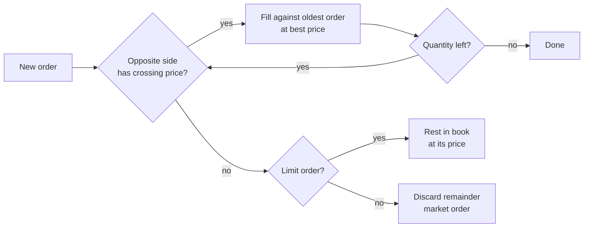

# Simple Order Book (C++17)


A small, dependency-free **limit order book and matching engine** written in modern C++.
It supports limit orders, market orders and cancellation, and matches orders using
**price-time priority** — the same rule used by most real stock and crypto exchanges.

The project was built to practise backend fundamentals: choosing data structures for
the access pattern, keeping state consistent, validating input, testing edge cases,
and measuring performance.

## Features

- **Limit orders** — match immediately if the price crosses, otherwise rest in the book
- **Market orders** — take all available liquidity; the unfilled remainder is discarded
- **Cancel** in O(1) via an order-id index
- **Price-time priority** — better price first, then first-come-first-served at the same price
- **Trades execute at the maker's price** (the order that was already resting)
- **Integer prices in ticks** (1 tick = 0.01) — no floating-point rounding errors
- Input validation (duplicate ids, zero/negative quantity, too many decimals, overflow)
- Interactive **CLI**, **unit tests** (17 cases), **benchmark**, and **GitHub Actions CI** on Linux/macOS/Windows

## Quick start

Requirements: CMake ≥ 3.16 and a C++17 compiler (GCC, Clang or MSVC).

```bash
cmake -S . -B build -DCMAKE_BUILD_TYPE=Release
cmake --build build

ctest --test-dir build --output-on-failure   # run unit tests
./build/orderbook_cli                         # interactive mode
./build/orderbook_cli < examples/session.txt  # scripted demo
./build/orderbook_bench 1000000               # benchmark
```

## Demo

```text
> SELL 100 101.50
> SELL 50 101.00
> SELL 75 101.00
> BUY 80 100.50
> BUY 120 100.00
> BOOK
=========== ORDER BOOK ===========
  ASK     101.50  x      100  (1 order)
  ASK     101.00  x      125  (2 orders)
  ---------------------------------
  BID     100.50  x       80  (1 order)
  BID     100.00  x      120  (1 order)
==================================

> BUY 75 101.00            # crosses the spread
ACK id=6 BUY 75 @ 101.00
TRADE buy=6 sell=2 qty=50 @ 101.00   # order #2 arrived first -> filled first
TRADE buy=6 sell=3 qty=25 @ 101.00

> MSELL 150                # market sell walks down the bids
TRADE buy=4 sell=7 qty=80 @ 100.50
TRADE buy=5 sell=7 qty=70 @ 100.00
```

| Command | Description |
|---|---|
| `BUY <qty> <price>` / `SELL <qty> <price>` | Limit order |
| `MBUY <qty>` / `MSELL <qty>` | Market order |
| `CANCEL <id>` | Cancel a resting order |
| `BOOK` | Show top 10 levels per side |
| `HELP`, `QUIT` | |

## Design

```
bids_  : std::map<Price, std::list<Order>, std::greater<>>   // highest price first
asks_  : std::map<Price, std::list<Order>, std::less<>>      // lowest price first
index_ : std::unordered_map<OrderId, {side, price, list::iterator}>
```

- **`std::map` per side** keeps price levels sorted, so the best price is always `begin()`.
- **`std::list` per price level** is a FIFO queue. Its iterators stay valid when other
  elements are inserted or removed, which lets the index store a direct pointer to each order.
- **`unordered_map` index** maps order id → exact position, so cancel does not need to search.
- Empty price levels are erased immediately, so `begin()` is always a real, tradable price.
- Buy and sell matching share **one templated `match()` function**; the side-specific
  part is just the price comparison.

### Complexity

| Operation | Time |
|---|---|
| Add limit order (no match) | O(log P) |
| Match | O(log P + F) |
| Cancel | O(1) amortised (+ O(log P) if the level becomes empty) |
| Best bid / best ask | O(1) |

*P = number of distinct price levels, F = number of orders filled.*

### Matching flow



## Project structure

```
orderbook-cpp/
├── include/orderbook/
│   ├── Types.hpp         # Order, Trade, Side, type aliases
│   ├── OrderBook.hpp     # public API of the matching engine
│   └── Parsing.hpp       # price/quantity parsing and formatting
├── src/
│   ├── OrderBook.cpp     # matching logic
│   └── Parsing.cpp
├── apps/
│   ├── cli.cpp           # interactive command-line front end
│   └── bench.cpp         # throughput benchmark
├── tests/test_main.cpp   # unit tests (no external framework)
├── examples/session.txt  # scripted demo
└── .github/workflows/ci.yml
```

## Testing

The tests cover price priority, FIFO time priority, partial fills on both the incoming
and the resting order, market orders on an empty book, cancelling from the middle of a
queue, cancelling an already-filled order, invalid input, and parsing edge cases.
The suite has also been run under AddressSanitizer and UndefinedBehaviorSanitizer:

```bash
cmake -S . -B build-asan -DCMAKE_BUILD_TYPE=Debug \
      -DCMAKE_CXX_FLAGS="-fsanitize=address,undefined -fno-omit-frame-pointer"
cmake --build build-asan && ./build-asan/orderbook_tests
```

## Benchmark

Random mix of 70% limit orders, 10% market orders and 20% cancels around a 2-unit
price band, single thread, Release build (GCC 13, cloud Linux VM):

```
operations : 1000000  (limit 700207, market 99575, cancel 200218)
trades     : 698527
throughput : ~2.8 M ops/sec
avg latency: ~360 ns/op
```

Numbers vary by machine; run `./build/orderbook_bench` to measure your own.

## Possible extensions

- Order modification (amend quantity / price)
- More order types: IOC, FOK, stop orders
- Expose the engine over a REST or TCP API (e.g. with Boost.Beast or Crow)
- Persist trades to a database and replay the book after a restart
- Multiple instruments, one book per symbol
- Faster data structures: intrusive lists and a memory pool instead of `std::list`

## License

MIT — see [LICENSE](LICENSE).
